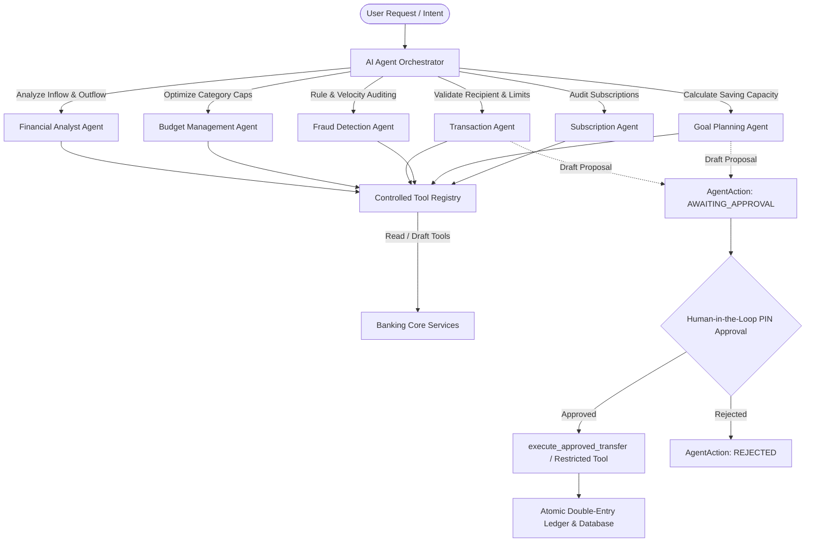

# FinPilot — AI-Powered Agentic Banking App


**FinPilot** is a modern, premium mobile digital banking application with integrated **Agentic AI workflows**. It pairs traditional digital banking functionality (accounts, cards, instant transfers, QR payments, category budgeting, and transaction history) with a **Multi-Agent Orchestrator** capable of analyzing financial health, discovering spending trends, drafting safe transfers, and creating structured savings plans under **strict human-in-the-loop authorization**.

---

## 1. UI Design & Reference Alignment

FinPilot's UI is designed with clean, minimalist aesthetics:

- **Soft Off-White Background**: `#F6F7F9`
- **Tall Teal/Turquoise Balance Card**: `#00D494`
  - Current Balance with eye visibility toggle
  - Mastercard overlapping red/orange badge
  - Navigation arrow
- **Load Money Card**: `#0084FF` with downward arrow
- **Send & Request Card**: `#FF6B57` with diagonal up-right arrow
- **Transactions Section**:
  - Rounded white container with "Transactions" title and coral "See all" action
  - Soft coral transaction icon with up-right arrow
  - Merchant/Counterparty: `SYED TEMOOR SHAH`
  - Timestamp: `6:23 PM`
  - Amount: `Rs. 10,000`
- **AI Agent Space**:
  - Clean, spacious, and reserved below Transactions
  - Interactive multi-agent launcher with quick-action prompt chips
- **Bottom Navigation**:
  - 4 tabs: `Personal`, `Payments`, `Scan QR`, and `More`

---

## 2. Multi-Agent AI Architecture

FinPilot implements a controlled **Agent Orchestrator** coordinating specialized domain agents:



### Specialized Agents

1. **Financial Analyst Agent**: Aggregates account balances, cash flow, income vs expenses, savings rates, and identifies top outflow drivers.
2. **Budget Agent**: Synthesizes personalized monthly budgets, calculates category limits, monitors budget utilization, and fires budget alerts.
3. **Transaction Agent**: Identifies recipients from user queries, resolves internal and external account numbers, validates single and daily transfer limits, and constructs transfer proposals.
4. **Fraud Detection Agent**: Uses deterministic risk rules alongside AI explanations to detect anomalous spending spikes, high-velocity transactions, and off-hour debits.
5. **Goal Planning Agent**: Formulates savings timelines, checks surplus feasibility, and generates structured monthly deposit plans.
6. **Subscription Agent**: Discovers active recurring debits (Netflix, Spotify, Gym, Fiber Internet) and computes annual commitments.

---

## 3. Controlled Tool Registry & Human-in-the-Loop Security

AI models are **never permitted to modify balances or directly execute sensitive banking operations**.

### Tool Classifications

- **READ TOOLS** (Safe, unprivileged):
  - `get_account_balance`
  - `get_transactions`
  - `get_spending_analytics`
  - `get_income_summary`
  - `get_expense_summary`
  - `get_budget_progress`
  - `get_savings_goals`
  - `get_recurring_transactions`
  - `get_beneficiaries`
- **DRAFT TOOLS** (Creates proposals requiring user confirmation):
  - `create_budget_draft`
  - `create_savings_goal_draft`
  - `create_transfer_draft`
  - `create_payment_draft`
- **RESTRICTED TOOLS** (Requires explicit human PIN authorization & server-side validation):
  - `execute_approved_transfer`
  - `freeze_card`
  - `update_security_settings`

### Agent Action Lifecycle

All sensitive proposals follow strict backend-governed state transitions:
`PLANNED` ➔ `VALIDATING` ➔ `AWAITING_APPROVAL` ➔ `APPROVED` ➔ `EXECUTING` ➔ `COMPLETED` (or `REJECTED` / `FAILED` / `EXPIRED`).

---

## 4. Banking Integrity & Double-Entry Ledger

FinPilot uses atomic transactions with double-entry ledger bookkeeping:

- Every outgoing transfer debits the sender account and credits either the recipient or the settlement reserve clearing account.
- **Invariance Rule**: $\sum \text{Debit} = \sum \text{Credit}$.
- **Idempotency Protection**: Unique idempotency keys prevent duplicate transfer executions on network retries.
- **Audit Logging**: Every action executed by the user or an AI agent creates an immutable record in `AuditLog`.

---

## 5. Technology Stack

### Mobile Frontend
- **Framework**: React Native with Expo SDK 58 (Expo Router)
- **Language**: TypeScript
- **State Management**: Zustand
- **Server Cache**: TanStack Query
- **Icons**: Lucide Icons (`lucide-react-native`)
- **Components**: Pixel-perfect custom fintech design system

### Backend Monolith
- **Runtime**: Node.js & Express.js
- **Language**: TypeScript
- **Database & ORM**: SQLite / PostgreSQL with Prisma ORM
- **Validation**: Zod
- **Security**: JWT tokens, bcrypt PIN hashing, rate-limiting, audit logging
- **Architecture**: Controller ➔ Service ➔ Repository ➔ Prisma Database

---

## 6. Getting Started

### Prerequisites
- Node.js `v18+` or `v20+` or `v24+`
- npm `v9+`

### 1. Backend Setup

```bash
cd backend

# Install dependencies
npm install

# Push Prisma schema to SQLite
npx prisma db push

# Seed simulated banking data
npm run seed

# Run automated tests (Unit & Financial Ledger Suite)
npm test

# Start Backend Server (runs on http://localhost:4000)
npm run dev
```

### 2. Mobile App Setup

```bash
cd mobile

# Install dependencies
npm install

# Start Expo dev server
npx expo start
```

Press `w` in terminal to launch in **Web browser**, or scan the QR code using Expo Go on iOS / Android!

---

## 7. Demo Accounts & Test Prompts

### Demo Credentials
- **Mobile Number**: `03001234567`
- **PIN**: `1234` (quick 1-click auto-unlock button available on PIN screen)
- **User**: Syed Temoor Shah
- **Initial Balance**: Rs. 145,000

### AI Prompts to Try in Copilot Workspace:

1. **AI Savings Plan**:
   > *"I want to save PKR 100,000 in four months."*
   - FinPilot coordinates Financial Analyst, Budget, and Goal Planning Agents, calculates surplus feasibility, and asks for goal activation.

2. **Smart Money Transfer**:
   > *"Send PKR 5,000 to Ali"*
   - Transaction Agent resolves Ali Khan (`1004892110`), validates balance, creates a transfer draft in `AWAITING_APPROVAL`, and prompts for 4-digit PIN authorization.

3. **Fraud & Risk Inspection**:
   > *"Check for fraud and unusual transactions"*
   - Fraud Detection Agent cross-references velocity rules, transaction anomalies, and provides a security risk explanation.

4. **Spending & Subscriptions Analysis**:
   > *"Analyze my spending and subscriptions"*
   - Subscription Agent reports all recurring commitments (Netflix, Spotify, Internet) and annual run rate.

---

## 8. License

FinPilot is developed for hackathon demonstration under the MIT License.
