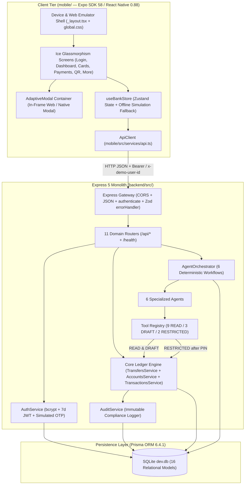
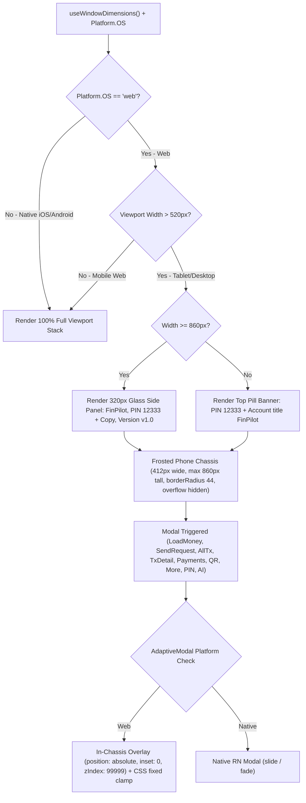
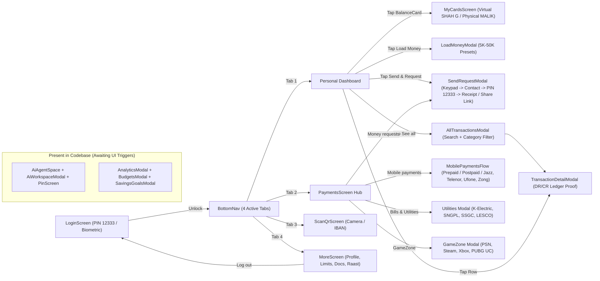
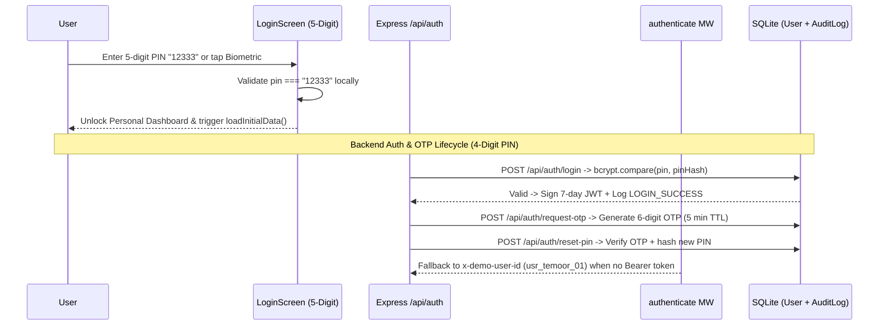
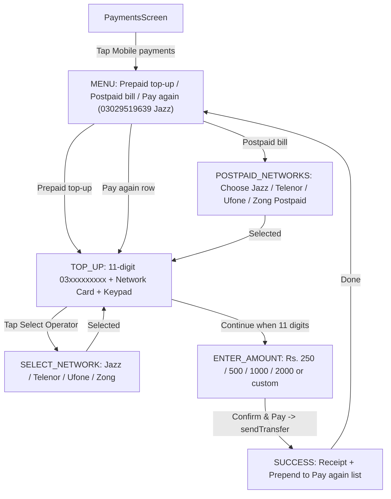
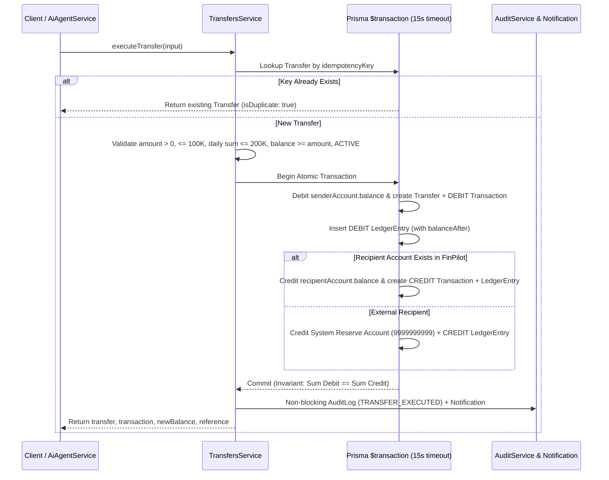
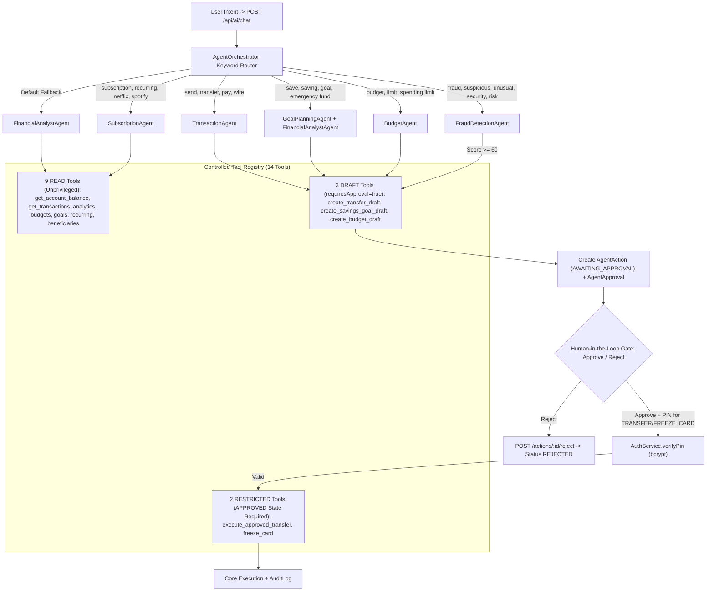
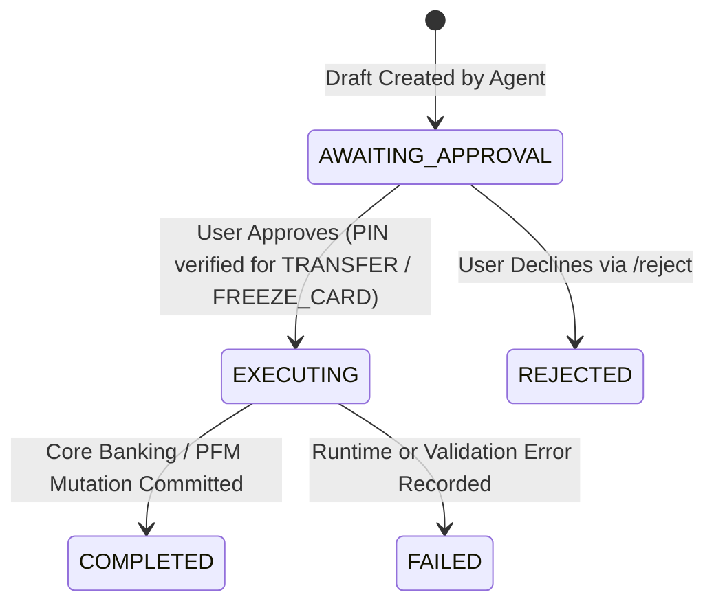
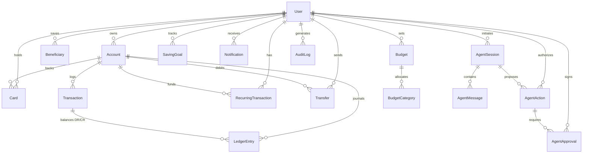

# Product Requirements Document (PRD): FinPilot Banking App

**Version:** v1.0  
**Repository:** [sayyedtaimoordev/FinPilot-App](https://github.com/sayyedtaimoordev/FinPilot-App.git)  
**Platforms:** iOS, Android, Mobile Web, Desktop Web (Dedicated Phone Emulator Shell)  
**Document Status:** As-Built Engineering & Product Specification (Verified against codebase)

> [!TIP]
> **Interactive Excalidraw Studio & Editable Diagrams Included:**  
> Open the visual Excalidraw-style interactive studio to zoom, pan, inspect source paths per node, and export/copy `.excalidraw` JSON:  
> - **[FinPilot_Architecture_Excalidraw.html](./FinPilot_Architecture_Excalidraw.html)**
>
> Editable `.excalidraw` v2 source files (compatible with Excalidraw web & IDE extensions):  
> 1. [01_system_architecture.excalidraw](./diagrams/01_system_architecture.excalidraw)  
> 2. [02_ai_multi_agent_hitl.excalidraw](./diagrams/02_ai_multi_agent_hitl.excalidraw)  
> 3. [03_double_entry_ledger.excalidraw](./diagrams/03_double_entry_ledger.excalidraw)  
> 4. [04_mobile_ui_navigation.excalidraw](./diagrams/04_mobile_ui_navigation.excalidraw)  
> 5. [05_database_er_architecture.excalidraw](./diagrams/05_database_er_architecture.excalidraw)  
> 6. [06_web_emulator_containment.excalidraw](./diagrams/06_web_emulator_containment.excalidraw)

---

## 1. Executive Summary & Product Vision

**FinPilot** is a cross-platform digital banking application paired with an **Agentic AI Financial Copilot** and backed by an atomic **Double-Entry Core Banking Ledger**. Designed around a translucent **Ice Glassmorphism** aesthetic, it provides everyday consumer banking workflows—PIN authentication, real-time balance tracking, virtual and physical debit card management, instant P2P transfers, payment requests, Pakistani telco prepaid/postpaid bill payments, utility bills, gaming vouchers, and QR merchant checkout—while embedding a multi-agent AI orchestrator governed by strict **Human-in-the-Loop (HITL)** approval gates.

### Key Pillars
1. **Minimalist & Translucent FinTech UX:** Responsive across native mobile viewports and desktop browsers via a clamped `412px` frosted-glass phone emulator frame.
2. **Ledger Integrity:** Every balance movement executes atomically inside database transactions following the double-entry bookkeeping invariant ($\sum \text{Debit} = \sum \text{Credit}$) with idempotency protection.
3. **Safe Agentic AI:** Specialized financial agents read analytics and draft proposals, but are strictly isolated from mutating balances without explicit user approval and PIN verification.

---

## 2. High-Level System & Deployment Architecture

> Excalidraw file: [01_system_architecture.excalidraw](./diagrams/01_system_architecture.excalidraw)

### Technology Stack
| Layer | Stack & Packages | Source Reference |
| :--- | :--- | :--- |
| **Frontend** | Expo `~58.0.26`, Expo Router `~58.0.32`, React `19.3.0`, React Native `0.88.1`, React Native Web `~0.21.4`, TypeScript `~6.0.3` | [mobile/package.json](../mobile/package.json) |
| **State & Data** | Zustand `^5.1.0`, TanStack React Query `^5.108.4`, Zod `^4.6.7` | [bank-store.ts](../mobile/src/store/bank-store.ts) |
| **UI & Media** | `lucide-react-native`, `react-native-svg`, `expo-camera`, `react-native-reanimated`, `react-native-safe-area-context` | [mobile/package.json](../mobile/package.json) |
| **Backend** | Node.js, Express `^5.3.0`, TypeScript `^5.7.3`, Zod `^4.6.7`, `bcryptjs`, `jsonwebtoken`, `uuid` | [backend/package.json](../backend/package.json) |
| **Database** | Prisma ORM `^6.4.1` with SQLite (`prisma/dev.db`) | [schema.prisma](../backend/prisma/schema.prisma) |
| **Testing** | Jest `^30.5.2`, `ts-jest`, Supertest | [finpilot.test.ts](../backend/tests/finpilot.test.ts) |

---

## 3. Target Personas & Demo Accounts

Seeded via [seed.ts](../backend/prisma/seed.ts) and mirrored in [bank-store.ts](../mobile/src/store/bank-store.ts):

| Entity | Seeded / Store Details | Role in System |
| :--- | :--- | :--- |
| **Primary User (`usr_temoor_01`)** | Name: `Syed Temoor Shah` (UI displays `Sayyed Taimoor Shah`), Phone: `03001234567`, Email: `temoor.shah@finpilot.io` | Retail banking customer owning primary account, cards, budgets, savings goals, and AI copilot sessions. |
| **Primary Account (`acc_temoor_primary`)** | Number: `1002345678`, IBAN: `PK36FINP0000001002345678`, Currency: `PKR` (`Rs.`), Seeded Balance: `145,000.0` | Default checking account (`isDefault: true`) for debits, loads, and transfers. |
| **Beneficiary Peer (`usr_ali_02`)** | Name: `Ali Khan`, Phone: `03009876543`, Account: `1004892110`, Seeded Balance: `45,000.0` | Internal FinPilot peer account used for instant P2P ledger credits. |
| **Reserve Clearing Account** | Account `9999999999` (`acc_finpilot_reserve`), Seeded Balance: `100,000,000.0` | System clearing account credited on external transfers and debited on inflow to uphold double-entry invariance. |
| **Saved Contacts (UI/Seed)** | `Ali Khan` (`1004892110`, FinPilot), `Fatima Zahra` (`0129384756`, HBL), `Hamza Ahmed` (`0987654321`, Meezan Bank), `Zainab Bibi` (`03112345678`, Raast) | Quick recipient selection in Send & Request and AI resolution. |

---

## 4. Design System & Web Emulator Containment Architecture

> Excalidraw file: [06_web_emulator_containment.excalidraw](./diagrams/06_web_emulator_containment.excalidraw)

### 4.1 Ice Glassmorphism Visual Language
Defined in [colors.ts](../mobile/src/theme/colors.ts) and [global.css](../mobile/src/global.css):
* **Canvas & Backdrop:** Crystalline ice tint (`#EDF5FC`) inside the app; radial dark obsidian background (`#0d1b2a` to `#040810`) on desktop web.
* **Frosted Glass Cards:** `rgba(255, 255, 255, 0.78)` with crystalline borders (`rgba(255, 255, 255, 0.88)`), cyan ambient drop shadows (`#38BDF8`), and Web CSS `backdrop-filter: blur(20px) saturate(180%)`.
* **Action Card Accents (with specular glint overlay):**
  * **Balance Card:** Luminous Teal Glass (`rgba(0, 212, 148, 0.92)`)
  * **Load Money:** Sapphire Blue Glass (`rgba(0, 132, 255, 0.92)`)
  * **Send & Request / Primary CTAs:** Coral Glass (`rgba(250, 104, 84, 0.92)`)

### 4.2 Responsive Shell & AdaptiveModal Flow

---

## 5. Mobile Application Navigation & Functional Flows

> Excalidraw file: [04_mobile_ui_navigation.excalidraw](./diagrams/04_mobile_ui_navigation.excalidraw)

### FR-1: Authentication & Security Gate
* **Files:** [LoginScreen.tsx](../mobile/src/components/LoginScreen.tsx), [PinScreen.tsx](../mobile/src/components/PinScreen.tsx), [auth.service.ts](../backend/src/modules/auth/auth.service.ts)
* **Authentication Flow:**

### FR-2: Personal Dashboard & Transactions
* **Files:** [BalanceCard.tsx](../mobile/src/components/BalanceCard.tsx), [ActionCards.tsx](../mobile/src/components/ActionCards.tsx), [TransactionsSection.tsx](../mobile/src/components/TransactionsSection.tsx), [LoadMoneyModal.tsx](../mobile/src/components/LoadMoneyModal.tsx), [AllTransactionsModal.tsx](../mobile/src/components/AllTransactionsModal.tsx), [TransactionDetailModal.tsx](../mobile/src/components/TransactionDetailModal.tsx)
* **Balance Card:** Displays formatted `Rs. <balance>` with an eye icon toggle masking value to `••••••` and Mastercard overlapping circles; tapping navigates to `MyCardsScreen`.
* **Load Money:** Quick presets (`5K`, `10K`, `25K`, `50K`) and custom numeric input calling `POST /api/accounts/load-money` (with local fallback).
* **Transactions:** Shows top 3 recent items on Dashboard, full filterable history (`ALL`, `TRANSFER`, `FOOD`, `BILLS`, `UTILITIES`, `ENTERTAINMENT`, `SALARY`) + text search in `AllTransactionsModal`, and **Double-Entry Ledger Proof** (`DR`/`CR`) in `TransactionDetailModal`.

### FR-3: Send & Request Flow
* **File:** [SendRequestModal.tsx](../mobile/src/components/SendRequestModal.tsx)
* **5-Step State Machine:**
  1. `KEYPAD`: Coral keypad displaying live balance, `Rs. <amount>` (up to 7 digits), dual `Request` and `Send` actions.
  2. `SELECT_RECIPIENT`: Manual IBAN/Account/Phone + Name input or contact picker (`Ali Khan`, `Fatima Zahra`, `Hamza Ahmed`, `Zainab Bibi`).
  3. `PIN_AUTH`: Strict 5-digit PIN (`12333`) check invoking `sendTransfer`.
  4. `SUCCESS`: Transfer receipt with reference number, timestamp, and ledger status.
  5. `REQUEST_LINK`: Share sheet generating `https://finpilot.me/pay/sayyed?amt=<amount>`.

### FR-4: Virtual & Physical Cards Management
* **File:** [MyCardsScreen.tsx](../mobile/src/components/MyCardsScreen.tsx)
* **Card Configurations:**
  | Tab | Card Number | CVV | Valid Thru | Cardholder | Card Surface |
  | :--- | :--- | :--- | :--- | :--- | :--- |
  | **Virtual** | `2621 0882 3080 2449` | `165` | `08/30` | `SHAH G` | Icy Mint (`#EDF4F3`) |
  | **Physical** | `2307 7954 2860 1307` | `496` | `02/31` | `MALIK` | Midnight Slate (`#1E293B`) |
* **Synchronized Hide/Show (`showDetails`, default `false`):** When hidden, no card number, CVV, Valid Thru, or bottom summary box is shown—only card type, monogram, holder name, eye pill, and Mastercard circles render. Tapping the eye icon toggles both the on-card credential overlay and the bottom copyable summary card together.
* **Freeze Card Switch:** Calls `POST /api/cards/:id/freeze`, dims card opacity (`0.72`), and shows a `FROZEN` badge.

### FR-5: Payments Hub & Pakistani Telco Flow
* **Files:** [PaymentsScreen.tsx](../mobile/src/components/PaymentsScreen.tsx), [MobilePaymentsFlow.tsx](../mobile/src/components/MobilePaymentsFlow.tsx)
* **Mobile Payments Flow Diagram:**

### FR-6 & FR-7: QR Payment Scanner & More Settings
* **QR Payment ([ScanQrScreen.tsx](../mobile/src/components/ScanQrScreen.tsx)):** `expo-camera` `CameraView` (`facing="back"`, `barcodeTypes: ['qr']`) extracting `iban=`/`name=` or URL hostname, alongside `MANUAL_ENTRY` (IBAN/alias) and payment amount confirmation modal.
* **More Tab ([MoreScreen.tsx](../mobile/src/components/MoreScreen.tsx)):** Profile card (`Sayyed Taimoor Shah`), Update Email modal, Rs. 400k Monthly Limit bar (`Rs. 390,000 left`), Documents (`Account statement`, `Tax refund statement`), Policies (`Privacy policy`, `Terms & conditions`, `Schedule of charges`), `Manage devices` (`Version v1.0`), `Raast ID management` (`0311-2345678`, `PK19SADA0000003112345678`), `Close account`, `Log out`, and `App version: v1.0` footer.

---

## 6. Core Banking Double-Entry Ledger Flow

> Excalidraw file: [03_double_entry_ledger.excalidraw](./diagrams/03_double_entry_ledger.excalidraw)

Implemented in [transfers.service.ts](../backend/src/modules/transfers/transfers.service.ts):
* **Ceilings:** `SINGLE_TX_LIMIT = PKR 100,000`, `DAILY_LIMIT = PKR 200,000`.
* **Transfer Execution Sequence:**

---

## 7. Multi-Agent AI Orchestrator & HITL Architecture

> Excalidraw file: [02_ai_multi_agent_hitl.excalidraw](./diagrams/02_ai_multi_agent_hitl.excalidraw)

Implemented across [orchestrator.ts](../backend/src/ai/orchestrator.ts), [registry.ts](../backend/src/ai/tools/registry.ts), and [ai-agent.service.ts](../backend/src/modules/ai-agent/ai-agent.service.ts):

### AgentAction Lifecycle State Diagram

### Fraud Scoring Heuristic ([fraud.agent.ts](../backend/src/ai/agents/fraud.agent.ts))
* Base risk score starts at `5`.
* **Spike Anomaly:** `+25` per debit transaction exceeding `3.5x` the average debit and `PKR 50,000`.
* **Velocity Anomaly:** `+15` if two debit transactions above `PKR 5,000` occur within `15 minutes`.
* **Risk Buckets:** `LOW` (`< 30`), `MEDIUM` (`30–59` suggesting `VERIFY_OTP`), `HIGH` (`>= 60` emitting `FREEZE_CARD` draft proposal).

---

## 8. Database Architecture (16-Model Prisma Schema)

> Excalidraw file: [05_database_er_architecture.excalidraw](./diagrams/05_database_er_architecture.excalidraw)

Defined in [schema.prisma](../backend/prisma/schema.prisma) on SQLite. All child entities cascade on `User` deletion except `AuditLog` (`onDelete: SetNull`) to preserve compliance traceability. Unique indices protect `User.email`, `User.phone`, `Account.accountNumber`, `Account.iban`, `Transaction.reference`, `Transaction.idempotencyKey`, and `Transfer.idempotencyKey`.

---

## 9. Backend REST API Contract

Mounted under [server.ts](../backend/src/server.ts) (`GET /health` public; routers guarded by `authenticate`):

| Module | Endpoint | Method | Purpose / Validation |
| :--- | :--- | :--- | :--- |
| **System** | `/health` | `GET` | Health check (`version: 1.0.0`) |
| **Auth** | `/api/auth/login` | `POST` | Public: `{ phone (min 10), pin (len 4) }` → JWT + user |
| | `/api/auth/verify-pin` | `POST` | Auth: `{ pin (len 4) }` → `{ isValid }` |
| | `/api/auth/request-otp` | `POST` | Public: `{ phone }` → 6-digit simulated OTP (5m TTL) |
| | `/api/auth/reset-pin` | `POST` | Public: `{ phone, code (6), newPin (4) }` |
| | `/api/auth/me` | `GET` | Auth: User profile + accounts + cards |
| **Accounts** | `/api/accounts`, `/default`, `/balance` | `GET` | User accounts, default checking account, available/locked balance |
| | `/api/accounts/load-money` | `POST` | `{ amount > 0, sourceName? }` → Atomic credit + ledger |
| **Transactions** | `/api/transactions` | `GET` | Filtered list (`category`, `type`, `search`, date range, pagination) |
| | `/api/transactions/recent` | `GET` | Recent N transactions (`?limit=5`) |
| | `/api/transactions/analytics` | `GET` | Total income, expense, net savings, category percentages |
| | `/api/transactions/:id` | `GET` | Transaction detail + ledger entries |
| **Transfers** | `/api/transfers/validate`, `/execute`, `/history` | `POST` / `GET` | Validate limits/balance, execute atomic double-entry transfer, list last 20 |
| **Beneficiaries** | `/api/beneficiaries`, `/:id` | `GET` / `POST` / `DELETE` | List, add, or delete saved payees |
| **Budgets** | `/api/budgets/current`, `/` | `GET` / `POST` | Retrieve current/latest budget; upsert monthly budget + categories |
| **Saving Goals** | `/api/saving-goals`, `/:id/deposit` | `GET` / `POST` | List/create targets; deposit (auto-completes at targetAmount) |
| **Cards** | `/api/cards`, `/:id/freeze`, `/:id/limit` | `GET` / `POST` | List cards, toggle `isFrozen` + audit log, update `dailyLimit` |
| **AI Agent** | `/api/ai/chat` | `POST` | `{ message, sessionId? }` → Multi-agent orchestration result |
| | `/api/ai/sessions`, `/:sessionId` | `GET` | List sessions & retrieve full transcript + actions |
| | `/api/ai/pending-actions` | `GET` | List `AWAITING_APPROVAL` actions |
| | `/api/ai/actions/:actionId/approve`, `/reject` | `POST` | Approve (with PIN verification when required) or reject action |
| **Notifications & Audit** | `/api/notifications`, `/:id/read`, `/api/audit` | `GET` / `POST` | Notification feed, mark read, audit log (latest 50) |

---

## 10. Verification & Observed Technical Debt

* **Verified Test Suite (`backend/tests/finpilot.test.ts`):** 4 Jest tests covering insufficient funds/limit rejection, atomic double-entry transfer balance invariant ($\sum \text{Debit} = \sum \text{Credit}$) + idempotency deduplication, AI savings goal approval, and AI transfer PIN rejection (`9999`) + approval (`1234`).
* **Type Verification:** Clean `tsc --noEmit` across `mobile/`.
* **Observed Integration Gaps for Future Alignment:**
  1. **PIN Length Mismatch:** `LoginScreen.tsx` and `SendRequestModal.tsx` check 5-digit PIN `'12333'`, whereas backend Zod schemas, `seed.ts`, `PinScreen.tsx`, `AiWorkspaceModal.tsx` (passing hardcoded `'1234'`), and Jest tests expect 4-digit `'1234'`.
  2. **Unmounted AI & PFM Modals in Navigation:** `AiAgentSpace`, `AiWorkspaceModal`, `AnalyticsModal`, `BudgetsModal`, and `SavingsGoalsModal` exist in `mobile/src/components/`, but active navigation does not currently render UI launch triggers for them in `index.tsx` / `MoreScreen.tsx`.
  3. **Static vs. API-Backed Cards & PFM:** `MyCardsScreen.tsx` displays local `CARDS_DATA` (`SHAH G` / `MALIK`) alongside API freeze toggling on the single seeded `Card` (`5412 •••• •••• 8824`); `BudgetsModal.tsx` and `SavingsGoalsModal.tsx` manage local state rather than syncing with `/api/budgets` and `/api/saving-goals`.
